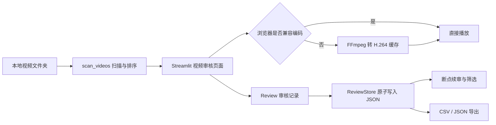

# 架构说明

## 数据流

## 模块职责

- `app.py`：页面布局、Session State、导航、审核表单和下载入口。
- `video_admire/core.py`：视频发现、自然排序、审核模型、JSON 持久化、统计和导出。
- `video_admire/media.py`：媒体探测、浏览器兼容判断、H.264 转码和缓存。
- `video_admire/taxonomy.py`：默认问题分类；新增问题类型优先修改这里。
- `tests/`：核心逻辑、媒体兼容、分类和 Streamlit 启动回归测试。

## 关键不变量

- `video_id` 是相对于用户所选根目录的 POSIX 风格相对路径，同名但不同目录的视频不会冲突。
- 审核写入使用临时文件加 `os.replace`，避免中途写入留下半个 JSON。
- 标记为“有问题”时问题描述不能为空。
- 原视频只读；不兼容媒体只在 `media_cache/` 生成可重新创建的副本。
- 已移走视频的历史记录不会混入当前视频集合的最终汇总。

